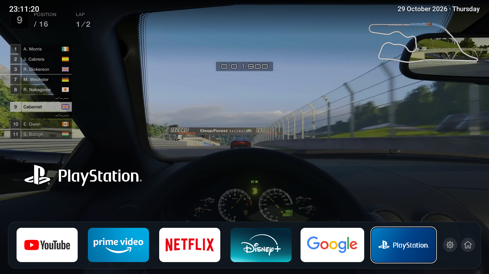
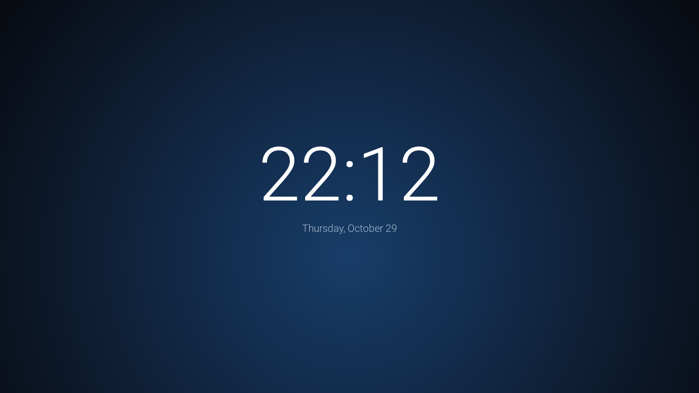

# tv

### Your TV. Your home screen.

A cinematic, remote-first home screen for Fire TV. Six destinations, live motion, publisher-provided app artwork, and a quiet ambient clock.



YouTube · Prime Video · Netflix · Disney+ · Google · PlayStation

- **One focused surface.** A full-screen motion preview and floating navigation panel with equal-width landscape cards. Installed streaming apps supply their original TV banners; Google uses its color wordmark on white; PlayStation uses its white lockup on a blue gradient. No sponsored content rows in this launcher.
- **Made for a remote.** D-pad navigation, a visible focus ring, and access to the original TV settings and Amazon Home.
- **Local playback.** One muted hardware video decoder; cached clips rotate without a computer or local server.
- **Independent refresh.** The optional ARMv7 runtime checks official channels daily, requests native 1080p H.264, validates files, and keeps three HD clips per destination. Failed downloads retain the cache.
- **A quieter idle screen.** A bold English clock over a muted, darkened nature video. Without the optional video, a dark fallback remains readable.
- **HDMI shortcut.** The PlayStation destination can open the configured HDMI input. It does not emulate or stream a console.



## Status

Personal project tested on a TCL Fire TV, Android 9 / Fire OS 7, ARMv7. This is an English public edition of a home installation. It is not an Amazon, TCL, Google, Sony, Netflix, Disney or Prime Video product.

The TV renders its interface at **1920 × 1080**. Screenshots are captured at that resolution. This is not a claim of a native 4K launcher. Home-button interception is firmware-specific; cold boot includes the manufacturer's firmware and Android startup. No universal boot-speed claim is made.

## Build

Install Python 3, JDK 17 or newer, Android SDK platform 34 and build-tools 36.0.0. Set `JAVA_HOME` and `ANDROID_SDK_ROOT`, then:

```sh
python3 build.py
```

The result is `build/tv.apk`, signed with a locally generated development key. The key is ignored by Git. Keep your own key if you want later builds to update the same installation.

The default build is small and uses poster fallbacks. No trailer files, downloader executables or private signing keys are committed. To enable independent video refresh on a compatible **32-bit ARM** device:

```sh
python3 fetch-runtime.py
python3 build.py
```

The bootstrap downloads pinned upstream Python, FFmpeg, Node, yt-dlp and EJS components. It checks upstream or committed SHA-256 hashes. Package mirrors can retire old versions; a failed checksum or missing version should be investigated, not bypassed. Review upstream licenses before redistributing a binary build. The bootstrap is syntax-checked; its full clean download path has not yet been tested end to end.

For your own locally licensed clips, place silent H.264 MP4 files in `assets/clips/` before building, named `youtube.mp4`, `prime.mp4`, `netflix.mp4`, `disney.mp4`, `google.mp4`, `playstation.mp4`. Additional files can use a suffix such as `netflix-02.mp4`. Runtime downloads live in the app's external files directory. When HD downloads exist for a destination, lower-resolution legacy clips are excluded from that destination's rotation.

## Install and Home button

Enable ADB debugging on your TV and approve your computer. Replace `TV_ADDRESS` with your own address:

```sh
adb connect TV_ADDRESS:5555
adb install -r build/tv.apk
adb shell am start -n local.tv.cardhome/.MainActivity
```

The normal app launcher works without Home interception. To use the optional Home router on compatible Fire OS 7 firmware:

```sh
adb shell pm grant local.tv.cardhome android.permission.READ_LOGS
```

Enable **TV — Home button** in the TV accessibility settings. The service matches the Fire TV Home-key policy log line and uses an accessibility overlay during the transition. It does not retrieve screen content or save log contents. READ_LOGS is a broad platform permission; the implementation deliberately filters for a specific key event.

Do not overwrite your list of enabled accessibility services with a generic shell command. Firmware may impose an alarm delay; inspect your own device before changing any global alarm settings. Keep Amazon Home and the system settings installed.

The Google destination opens Google in Amazon Silk; it is not Chrome. Streaming apps must be installed separately and may require subscriptions.

## HDMI

In this version the PlayStation tile first uses the companion package `local.tv.ps4hdmi1`, if installed. Otherwise it offers a list of the device's HDMI inputs; select the one connected to your console. That choice is stored locally. Input identifiers differ across manufacturers. HDMI signal and CEC behavior remain controlled by the TV.

## Restore

Turn off this app's accessibility service, return to Amazon Home, and uninstall the app through TV settings if desired. No debloat commands run during installation. The original launcher, OTA updates, input services, Bluetooth and DRM components are not removed.

## Architecture

Native Java / Canvas layout → a single TextureView + MediaPlayer → bounded local clip cache. A separate JobScheduler process handles refresh with a daily network constraint and exponential backoff. Refresh waits through the first three minutes after boot. There is no web server, cloud backend, account login, analytics SDK, or Mac scheduler in this project.

The on-device extractor can stop working when upstream websites change. Cached playback survives a refresh failure; the bundled extractor may need an app rebuild later. Channel feeds are promotional sources, not private Netflix/Prime account catalog APIs.

## Verification

See [verification](docs/verification.md), [device cleanup research](docs/debloat.md), and [credits](CREDITS.md). No system packages were disabled as part of this release.

## Share

The images in `screenshots/` are captures of the running interface. `social/` contains English presentation layouts using those captures. A suggested post is in [social/post.txt](social/post.txt).

Code is MIT licensed. Third-party wordmarks and promotional imagery remain the property of their owners and are excluded from that license. See [credits](CREDITS.md).

### Optional nature background

Run `python3 fetch-nature.py` before building (requires FFmpeg). It downloads a real waterfall clip from Mixkit and prepares a muted 1080p local loop. The TV plays it without a Mac or network connection. Video files are excluded from Git.

On some firmware, Home routing can be cleared by an APK update or force-stop. Re-enable the accessibility service after installation, preserving other enabled services; use the full component name `local.tv.cardhome/local.tv.cardhome.HomeGuard`.
